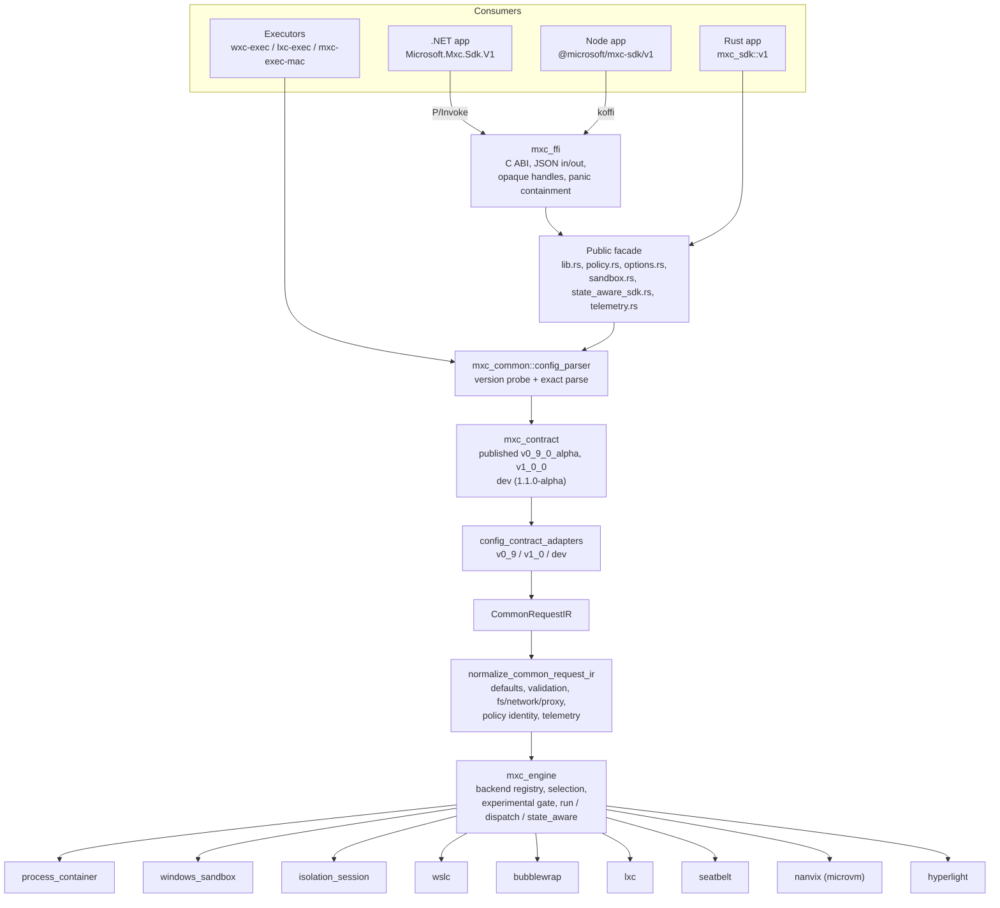
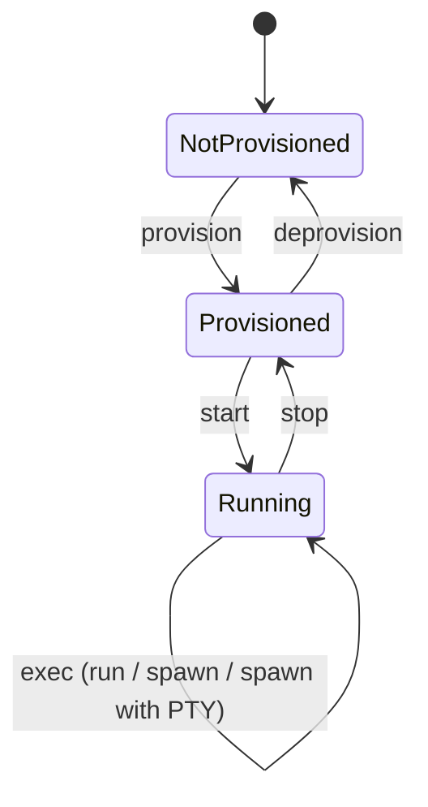

# MXC (Microsoft eXecution Container): Project Analysis

> Snapshot analysis of the `kierunb/mxc` repository (workspace version `1.0.1`,
> latest stable contract `1.0.0`). It describes what the project is, how it is
> built, how it works internally, and the full feature set as seen in the code,
> samples, tests, and documentation.

---

## 1. Executive summary

MXC is a **cross-platform sandboxed code execution system**. An application
embeds the MXC SDK (Rust, .NET, or Node) and asks it to run a command, such as
model-generated code, a plugin, or a tool, inside an isolated container. The
caller declares:

- **which kind of containment** to use (an abstract "process" intent or a
  concrete backend);
- **the containment rules** (filesystem, network, UI, environment, timeout, and
  backend-specific settings);
- **the workload command**.

MXC validates the request against an exact, versioned JSON contract, rejects
anything the selected backend cannot enforce (**fail-closed**), selects the
backend, launches the workload, and returns either captured results or live
process handles (pipes or a pseudo-terminal).

Containment ranges from OS-native process sandboxes to full virtual machines:

| Host | Default backend | Other backends |
|---|---|---|
| Windows 11 x64/ARM64 | `processcontainer` (AppContainer/LPAC + PSEC + Job Objects) | `wslc`, `isolation_session`, `windows_sandbox`*, `microvm`*, `hyperlight`* |
| Linux x64/ARM64 | `bubblewrap` (namespaces + bind mounts + seccomp) | `lxc`, `microvm`*, `hyperlight`* |
| macOS ARM64/x64 | `seatbelt` (kernel sandbox profile via `sandbox_init`) | — |

\* experimental; requires explicit opt-in (`--experimental` / experimental flag).

All execution logic is native Rust in a single crate (`mxc-sdk`). The .NET and
Node SDKs are thin, typed façades that call that native code through a C ABI
(`mxc_ffi`).

---

## 2. Repository at a glance

### 2.1 Layout

```text
mxc/
├── src/                         Rust workspace (toolchain pinned to 1.93 in rust-toolchain.toml)
│   ├── mxc-sdk/                 The product: SDK facade, engine, common layer, contracts, backends
│   │   ├── src/
│   │   │   ├── lib.rs, policy.rs, options.rs, sandbox.rs, state_aware_sdk.rs, telemetry.rs, configs/
│   │   │   ├── core/            mxc_engine, mxc_common, mxc_contract, mxc_pty, mxc_telemetry,
│   │   │   │                    mxc_schema_support, learning_mode_core, learning_mode_windows,
│   │   │   │                    process_security_environment_spec
│   │   │   ├── backends/        process_container, windows_sandbox, isolation_session, wslc,
│   │   │   │                    bubblewrap, lxc, seatbelt, nanvix (MicroVM), hyperlight
│   │   │   └── bin/             windows_sandbox_daemon, windows_sandbox_guest, wslc_daemon (sidecars)
│   │   ├── build.rs + build/    Build-time staging: bindings, Nanvix binaries, WSLC SDK, version resources
│   │   └── tests/               Contract, streaming, state-aware and end-to-end characterization tests
│   ├── ffi/mxc_ffi/             C ABI used by the .NET and Node SDKs
│   ├── tools/                   Executors and tools: wxc (wxc-exec), lxc (lxc-exec),
│   │                            mxc_darwin (mxc-exec-mac), mxc_diagnostic_console, mxc_schema_gen
│   └── testing/                 Test helpers (wxc_test_driver, wxc_test_proxy, wxc_ui_probe,
│                                unix_test_proxy) and fuzz targets
├── sdk/
│   ├── dotnet/                  Microsoft.Mxc.Sdk (net8.0) + tests, AOT smoke test, console driver, packaging
│   └── node/                    @microsoft/mxc-sdk (TypeScript, Node >= 24, koffi FFI, node-pty)
├── samples/                     10 scenarios, each in Rust, .NET, and Node
├── schemas/                     stable/ (immutable, 0.4.0-alpha … 1.0.0), dev/ (1.1.0-alpha), schema-version.json
├── docs/                        Consumer docs, API references (rust/dotnet/node v1), backend guides, dev docs
├── tests/                       Config/policy fixtures, regression tests, host-level scripts (PowerShell/sh)
├── scripts/                     CI matrix resolution, versioning sync checks, setup helpers
├── .github/workflows/           GitHub Actions: build, lint, SDK tests, validation matrix, e2e per backend
├── .azure-pipelines/            1ES official builds, release (crates/NuGet/npm), fuzzing, test bundles
└── build.sh / build.bat / build-mac.sh
```

### 2.2 Size (approximate line counts)

| Area | Lines |
|---|---:|
| `mxc-sdk/src` total (Rust) | ~190,000 |
| ├─ `core/` (engine, common, contracts, PTY, telemetry, learning mode) | ~87,000 |
| ├─ `backends/` | ~84,000 |
| └─ `bin/` (sidecar daemons) | ~12,000 |
| `mxc-sdk/tests` | ~22,700 |
| `ffi/`, `tools/`, `testing/` | ~5,500 / ~9,200 / ~2,900 |
| .NET (C#, SDK + samples) | ~15,600 |
| Node (TS/JS, SDK + samples) | ~24,700 |

Largest backends: WSLC (~18K), Bubblewrap (~16K), LXC (~12.6K), IsolationSession
(~11.4K), Windows Sandbox (~9.1K), ProcessContainer (~8.9K), Seatbelt (~4.3K),
Hyperlight (~2.2K), Nanvix (~1.7K). The largest single core module is
`mxc_common` (~47K), which holds parsing, normalization, policy processing,
streaming adapters, and telemetry.

---

## 3. Architecture

### 3.1 Layered design



### 3.2 Layer responsibilities

| Layer | Location | Responsibility |
|---|---|---|
| **Public facade** | `src/mxc-sdk/src/lib.rs`, `policy.rs`, `options.rs`, `sandbox.rs`, `state_aware_sdk.rs`, `telemetry.rs`, `configs/` | Versioned `mxc_sdk::v1` surface: typed `ContainerRequest`, `Containment`, policy types, options, process handles, lifecycle operations, probes, telemetry consent. Hides contracts and backend construction. |
| **Contracts** | `core/mxc_contract/{published/v0_9_0_alpha, published/v1_0_0, dev}` | Exact, closed wire types (`deny_unknown_fields`). Published modules are immutable; `dev` is the mutable next version. `registry.rs` registers each version's status, schema path, and generated TS/C# artifact paths. |
| **Adapters** | `core/mxc_common/config_contract_adapters/{v0_9, v1_0, dev}` | Convert each exact contract into the private `CommonRequestIR`, isolating wire-version differences. |
| **Common layer** | `core/mxc_common/` | Cross-platform semantics: `config_parser.rs`, `common_request_ir.rs`, `models.rs`, `network_parser.rs`, `proxy_env.rs`, `policy_identity.rs`, `exec_stream.rs`, `state_aware_dispatch.rs`, error envelopes, telemetry plumbing. Has **no** dependency on backend implementations. |
| **Engine** | `core/mxc_engine/` (`mod.rs`, `run.rs`, `dispatch.rs`, `state_aware.rs`, `backend_registry.rs`, `experimental.rs`) | The single execution engine. Resolves the backend, enforces experimental opt-in, routes run-to-completion, streaming, PTY, and lifecycle requests. Executors and SDK facades delegate here. |
| **Backends** | `backends/*` | Concrete containment implementations, each gated by `cfg(target_os)` and/or Cargo feature. |
| **Sidecars** | `src/bin/*` | `wxc-windows-sandbox-daemon`, `wxc-windows-sandbox-guest`, `wxc-wslc-daemon` (needs `--features wslc`). Ordinary Cargo `[[bin]]` targets. |
| **Support modules** | `core/mxc_pty`, `mxc_telemetry`, `mxc_schema_support`, `learning_mode_core`, `learning_mode_windows`, `process_security_environment_spec` | PTY abstraction, ETW TraceLogging, schema helpers, denial-capture analysis, Windows ETL/TDH decoding, PSEC layout spec. |

### 3.3 Architectural invariants (enforced by design and review)

- `mxc_common` is the cross-platform foundation; backend execution never moves
  into it, and it does not depend on backends.
- `mxc_engine` is the **only** place that routes to backends. The executor
  binaries (`wxc`, `lxc`, `mxc_darwin`) stay thin and contain no
  backend-selection logic.
- Implementation stays inside the `mxc-sdk` crate as modules, not as separate
  workspace crates.
- Build-time staging lives in `mxc-sdk/build/`, never in runtime modules.
- **Fail-closed policy**: unsupported fields or combinations are rejected
  *before* any container is created. There is no silent fallback to a weaker
  backend or configuration (e.g. requesting LXC on an unsupported host returns
  `backend_unavailable`, not Bubblewrap).
- Optional-field presence is preserved through parsing; defaults and semantic
  validation happen in the backend/normalization step, not in shared parsing.
- No panic unwinds through the C ABI.
- Released schemas under `schemas/stable/` are never edited.

---

## 4. Internals

### 4.1 Request pipeline (end-to-end)

1. **Input.** A request arrives as JSON text, base64 JSON, a file path
   (executors), or a typed SDK object (Rust `ContainerRequest`, .NET
   `ContainerRequest`, TS `ContainerRequest`). The .NET/Node SDKs serialize
   typed requests into MXC request JSON before crossing the FFI.
2. **Load and probe version.**
   `mxc_common::config_parser::load_mxc_request_with_options` decodes the input
   (`LoadOptions` supports base64 and CLI replacement of `process.commandLine`)
   and calls `mxc_contract::probe_version`.
3. **Exact parse.** The document is deserialized into exactly one of
   `ExactOneShotContract::{V0_9, V1_0, Dev}` (or the matching state-aware
   phase type). Unknown fields are errors. Failures are classified as
   `Decode`, `Version`, `OneShot`, `OneShotMalformed`, or `StateAware`;
   state-aware failures are rendered as structured JSON envelopes.
4. **Adapt.** `v0_9::/v1_0::/dev::one_shot_into_common_request_ir` produce a
   `CommonRequestIR` carrying contract version, phase, IDs, containment,
   process, lifecycle, filesystem, network, UI, runtime config, telemetry, and
   backend-specific sections.
5. **Normalize.** `normalize_common_request_ir` produces the internal
   `ExecutionRequest`: defaults, command-line interpretation, filesystem path
   canonicalization, network rule parsing, proxy environment derivation,
   policy identity, and telemetry initialization.
6. **Engine.**
   - `mxc_engine::run` / `resolve_runner` → run-to-completion `ScriptRunner`.
   - `mxc_engine::dispatch` → streaming `SandboxProcess` (pipes or PTY).
   - `mxc_engine::state_aware::run_state_aware` → lifecycle phases.
   - `experimental::require_experimental_optin` rejects experimental backends
     without opt-in.
7. **Backend execution**, then results: a captured execution envelope
   (stdout, stderr, exit code, timeout flag, warnings, metadata) or a live
   process handle.

### 4.2 Execution modes

| Mode | Engine path | Result |
|---|---|---|
| **Create-and-run, captured** (`run`) | `mxc_engine::run` → `ScriptRunner` | `ExecutionResult` with `stdout`, `stderr`, `outcome` (`Exited(code)` / `TimedOut`), `warnings`. |
| **Create-and-run, streaming** (`spawn`) | `mxc_engine::dispatch::spawn_runner` → `SandboxProcess` | `MxcProcess`: stdin/stdout/stderr streams, `wait`, `try_wait`, `kill`, metadata, warnings. Supported for ProcessContainer, WSLC, IsolationSession, Bubblewrap, LXC, and Seatbelt. |
| **Create-and-run, PTY** (`spawn_with_pty`) | `mxc_engine::dispatch::spawn_pty_runner` + `mxc_pty` | `MxcPtyProcess`: merged terminal I/O, resize (default 24×80), wait, kill. Native PTY dispatch supports IsolationSession, Bubblewrap, Seatbelt, and LXC; other backends are rejected before launch. |
| **Container lifecycle** | `state_aware::run_state_aware` + `mxc_common::state_aware_dispatch` | `provision` → `start` → `exec`* → `stop` → `deprovision`, with an opaque `ContainerId`. |
| **Dry run / validation** | lifecycle `dry_run`, executor `--dry-run`, SDK `validate_*` | Full parse, binding, phase, ID, and policy validation without executing. |
| **Probe / discovery** | `available_backends`, `platform_support`, `probe(request)` | Usable backends on this host (with capabilities), and whether a specific request can be enforced. |

Lifecycle state machine:



`ContainerId` values are opaque and must be passed back unchanged (e.g.
Windows Sandbox uses `wsb:<token>`). The dev contract (1.1.0-alpha) adds
WSLC-specific `provision-session` / `deprovision-session` phases for shared
WSLC sessions.

`mxc_common::exec_stream::ExecSandboxProcess` adapts a lifecycle backend's
`ExecHandle` into the common `SandboxProcess`: it duplicates native handles,
uses cancellable readers and a background waiter thread, and kills an
already-started process if stream setup fails, so no orphan processes or
undrained-pipe deadlocks occur.

### 4.3 Request and policy model (contract 1.0.0)

Root type: `mxc_contract::published::v1_0_0::one_shot::Request`.

| JSON section | Fields |
|---|---|
| root | `$schema`, `_comment`, `version`, `containerId`, `containment` |
| `process` | `commandLine`, `cwd`, `env`, `inheritDefaultEnv`, `timeout` |
| `lifecycle` | `destroyOnExit`, `preservePolicy` |
| `filesystem` | `readwritePaths`, `readonlyPaths`, `deniedPaths` |
| `fallback` | `allowDaclMutation` |
| `network` | `egress { default, allow[], deny[] }`, `ingress { default, hostLoopback }`; rules use `to { cidr, except }` and `ports { port, endPort, protocol }` |
| `ui` | `disable`, `clipboard`, `injection` |
| `runtimeConfig` | `networkProxy` |
| `telemetry` | `enabled` |
| `processContainer` | `leastPrivilege`, `learningMode`, `capabilities`, `captureDenials { mode, outputPath, retainEtl }`, `ui { isolation, desktopSystemControl, systemSettings, ime }`, `filesystem { enumeratePaths }`, `network { allowedProxyPeer }` |
| `lxc` | `distribution`, `release` |
| `seatbelt` | `profileOverride`, `guiAccess`, `nestedPty`, `keychainAccess`, `extraMachLookups` |
| `wslc` | WSLC image/session/storage settings |

The dev contract adds Windows Sandbox, Hyperlight, and expanded WSLC/session
sections. The capability wrapper reserves `learningModeLogging` and
`permissiveLearningMode`, so security-sensitive behavior can only be enabled
through the dedicated `learningMode`, `captureDenials`, or audit controls.

In the typed Rust SDK, containment is expressed by `mxc_sdk::v1::Containment`:

| Variant | Meaning |
|---|---|
| `Process` (default) | Abstract OS-native process isolation: ProcessContainer (Windows), Bubblewrap (Linux), Seatbelt (macOS). |
| `ProcessContainer(ProcessContainerConfig)` | Windows ProcessContainer with explicit settings. |
| `Seatbelt(SeatbeltConfig)` | macOS Seatbelt with explicit settings. |
| `Lxc(LxcConfig)` | Linux LXC with distribution/release. |
| `Bubblewrap` | Linux Bubblewrap. |
| `Wslc(WslcConfig)` | WSL container on Windows (needs `wslc` feature). |
| `IsolationSession` | Windows isolated user session (needs `isolation_session` feature). |

Experimental backends (`windows_sandbox`, `microvm`, `hyperlight`) are reachable
through MXC request JSON and the executors, not through the typed V1 SDKs.

### 4.4 Versioning and schemas

`schemas/schema-version.json` is the canonical source:

```json
{
  "min": "0.9.0-alpha",
  "maxSupported": "1.1.0-alpha",
  "stateAware": "0.9.0-alpha",
  "stateAwareWindowsSandbox": "1.1.0-alpha",
  "stateAwareWslc": "1.1.0-alpha",
  "stableLatest": "1.0.0",
  "sdkMajorTargets": { "1": "1.0.0" }
}
```

- **Stable schemas** (`schemas/stable/`): `0.4.0-alpha` through `1.0.0`;
  immutable once released. The parser currently accepts `0.9.0-alpha`,
  `1.0.0`, and `1.1.0-alpha` (registered exact versions within min/max).
- **Development schema** (`schemas/dev/mxc-config.schema.1.1.0-alpha.json`):
  generated by `src/tools/mxc_schema_gen` (with the `schema-gen` feature and
  `schemars`); never hand-edited. Generated TypeScript wire types live in
  `sdk/node/src/generated/{v0_9_0_alpha, v1_0_0, v1_1_0_alpha}`, and C# types
  in `sdk/dotnet/Microsoft.Mxc.Sdk/Generated`.
- **Promotion** creates a new immutable schema and contract module, then
  updates the stable/SDK targets. There is no implicit aliasing.
- **Publication vs. experimental authorization are separate.** A feature can
  sit at its permanent JSON location in the dev contract while still needing
  runtime experimental opt-in.
- Lifecycle versions are tracked independently per backend
  (`stateAware`, `stateAwareWindowsSandbox`, `stateAwareWslc`).

### 4.5 Backend registry and selection

`core/mxc_engine/backend_registry.rs` registers ten canonical names:

| Wire name | Experimental | Host detection |
|---|---|---|
| `processcontainer` | no | Windows |
| `wslc` | no | Windows |
| `lxc` | no | Linux |
| `vm` | no | Abstract VM intent; not yet implemented as a concrete runner |
| `microvm` | **yes** | No hypervisor detector yet |
| `hyperlight` | **yes** | Windows, Linux |
| `windows_sandbox` | **yes** | Windows |
| `isolation_session` | no | Windows |
| `seatbelt` | no | macOS |
| `bubblewrap` | no | Linux |

Selection rules: the abstract `process` intent resolves per host; a concrete
backend is used exactly as requested or fails with a typed error
(`unsupported_containment` / `backend_unavailable`). Probe results describe
backends that are usable on the current host, not merely compiled.

### 4.6 Cargo features and platform gates

| Feature | Enables |
|---|---|
| *(default)* | ProcessContainer (Windows), Bubblewrap + LXC (Linux), Seatbelt (macOS) |
| `wslc` | WSLC backend and `wxc-wslc-daemon` (`libloading`, `tar`; implies `link-wslcsdk` → `zip`) |
| `isolation_session` | IsolationSession WinRT bindings (`windows-collections`, `windows-future`) |
| `microvm` | Nanvix MicroVM runner |
| `hyperlight` | Hyperlight via `hyperlight-unikraft` (x86_64; `ureq`, `flate2`, `tar`) |
| `schema-gen` | `schemars` derives for schema generation |
| `test-support` | Internal test facilities |

Build script (`src/mxc-sdk/build.rs` + `build/`): generates IsolationSession
WinRT bindings, stages/links the WSLC SDK, downloads and checksum-verifies
Nanvix runtime binaries (`NANVIX_BIN` allows offline builds), and embeds
Windows version resources. It never invokes Cargo recursively.

### 4.7 Error model

Errors are typed and structured, never converted into success-shaped output.
Categories include malformed request, unsupported containment, unsupported
phase, backend unavailable, backend error, malformed/stale container IDs,
lifecycle state errors, policy validation errors, timeouts, and telemetry
consent persistence failures. The FFI maps these to status codes (plus
`MXC_STATUS_PANIC`, null argument, invalid UTF-8), and each SDK re-exposes them
(`mxc_error_from_code` / `MxcException` + `ErrorCode` / `mxcErrorFromCode`).

---

## 5. Backends in detail

### 5.1 Summary matrix

"Spawn" and "PTY" refer to the native engine's create-and-run dispatch
(`core/mxc_engine/dispatch.rs`: `spawn_runner`, `spawn_pty_runner`).

| Backend | Host | Isolation mechanism | Filesystem policy | Network policy | Spawn (streams) | PTY | Lifecycle | Status |
|---|---|---|---|---|---|---|---|---|
| ProcessContainer | Windows 11 (24H2+ family) | AppContainer/LPAC token, PSEC (`CreateProcessSecurityEnvironment`), Job Objects, ACLs, Firewall | RO / RW / denied / enumerate-only (OS-dependent) | Capability-based egress/ingress, proxy with peer identity | ✔ | Node SDK only (runs `wxc-exec` under node-pty) | create-and-run | stable (default) |
| Windows Sandbox | Windows | Hyper-V VM via `WindowsSandbox.exe` + guest agent | Mapped RO/RW shares (provision only), non-conflicting denies | Guest firewall isolation; network sections rejected in lifecycle | captured; output relayed by daemon in lifecycle `exec` | — | ✔ (daemon) | experimental |
| IsolationSession | Windows (preview OS feature) | OS `Windows.AI.IsolationSession.Preview` WinRT API | not accepted | Unrestricted only (explicit allow) | ✔ | ✔ (console relay) | ✔ | `isolation_session` feature |
| WSLC | Windows + WSL | Linux container via WSLC SDK DLL | Linux/WSL mounts | All-or-nothing; reachable proxy | ✔ | — | ✔ (daemon) | `wslc` feature |
| Bubblewrap | Linux (bwrap ≥ 0.5.0) | User/PID/mount/IPC/UTS/net namespaces, bind mounts, seccomp socket filter | RO / RW / denied (masked) | Private netns; slirp4netns + iptables rules; loopback proxy | ✔ | ✔ | create-and-run | stable (default) |
| LXC | Linux (LXC 5.0+) | liblxc container, full namespaces | RO / RW / denied (masked) | Per-container iptables egress/ingress chains; proxy relay | ✔ | ✔ | persistent container via `destroyOnExit`, no lifecycle API | stable |
| Seatbelt | macOS | Generated SBPL profile applied with `sandbox_init()` | RO / RW / denied (deny-wins) | Kernel egress/ingress, host-loopback, localhost proxy | ✔ | ✔ | create-and-run | stable (default) |
| Nanvix MicroVM | Windows (WHP), Linux (KVM) | Hardware-isolated MicroVM (`nanvixd`) | Copy-in/copy-back staging, RO staging | All-off or unrestricted | — (run only; live stdout/stderr relay) | — | create-and-run | experimental |
| Hyperlight | x86_64 Windows (WHP) / Linux (KVM) | Unikraft guest via `hyperlight-unikraft`, snapshot restore | Mounts under `/host/<name>` | none (rejected) | — | — | create-and-run | experimental |

### 5.2 ProcessContainer (Windows, default)

`backends/process_container/common/base_container_runner.rs`.

- Builds a restricted security environment through PSEC
  (`CreateProcessSecurityEnvironment`), launches the process **suspended**,
  assigns it to a Job Object, then resumes, so descendants cannot escape the
  job.
- Uses AppContainer or Low Privilege AppContainer (`leastPrivilege`) tokens.
  Network access maps to capabilities such as `internetClient` and
  `privateNetworkClientServer`; Windows cannot express every abstract
  ingress/egress combination independently, and those limits are documented.
- **Proxy**: packaged proxies are identified by Package Family Name,
  unpackaged AppContainer proxies by profile name (`allowedProxyPeer`).
  Administrator-owned firewall rules are created and removed per run.
- **UI policy** through Job Object UI limits (`READCLIPBOARD`,
  `WRITECLIPBOARD`, `GLOBALATOMS`, `DESKTOP`, `EXITWINDOWS`): clipboard
  `none|read|write|all`, desktop/atom isolation, system settings, IME.
  Support is OS-version-probed (`common/probe.rs`, `common/job_object.rs`).
- Capability-probes PSEC exports (denied paths, enumerate-only paths, Learning
  Mode exports) instead of trusting OS version strings; missing support →
  `backend_unavailable`.
- Optional `fallback.allowDaclMutation` and `captureDenials` (see §7).

### 5.3 Windows Sandbox (experimental)

`backends/windows_sandbox/` + `bin/windows_sandbox_daemon` +
`bin/windows_sandbox_guest`.

- **Create-and-run**: acquire the single per-logon-session VM slot, generate a
  `.wsb` configuration and bootstrap, launch, rendezvous with the guest agent,
  run one command (`cmd.exe /C`), capture streams, tear down.
- **Lifecycle**: `provision` stores immutable filesystem policy and returns
  `wsb:<token>`; `start` launches a detached `wxc-windows-sandbox-daemon.exe`
  that owns the VM; `exec` reuses it; `stop`/`deprovision` tear down and
  remove records under `%TEMP%\wxc-wsb\state-aware` (owner-only ACLs).
- **Host↔guest protocol**: four TCP channels (control, stdin, stdout, stderr),
  each authenticated by a 32-byte per-launch nonce and a role byte. The
  control channel starts with `WSBP` + version, then length-prefixed JSON
  frames (`Ready`, `Exec`, `Exit`, `StreamsReady`, `Ping`, `Pong`).
- **Executor↔daemon IPC**: nonce-authenticated localhost line protocol
  (`PING`/`PONG`, `STOP`/`OK`, `EXEC` with binary frames; `ERR busy`,
  `ERR not_ready`).
- Orphan cleanup requires PID + process-creation-time proof;
  `wxc-exec --force-reclaim` is the explicit, dangerous override.
- Guest firewall blocks external networking by default; network/UI/proxy
  policy is rejected in lifecycle mode.

### 5.4 IsolationSession (Windows, `isolation_session` feature)

`backends/isolation_session/` (generated bindings in `bindings/`, manager in
`common/manager.rs`).

- Uses the OS-provided `Windows.AI.IsolationSession.Preview` WinRT API to
  create a separate isolated Windows user session. Image-free and
  language-agnostic.
- Supports create-and-run (PTY-aware, ConPTY-style relay) and full lifecycle.
- Accepts **no** filesystem, proxy, or custom UI policy; network must be
  explicitly unrestricted. Anything else is rejected.
- Used by the `run-in-persisted-container` sample.

### 5.5 WSLC (Windows, `wslc` feature)

`backends/wslc/` + `bin/wslc_daemon/` (`session_manager.rs`,
`control_server.rs`).

- Runs Linux containers on Windows through the WSL Container SDK DLL
  (`wslcsdk_sys.rs`, `wslc_bindings.rs`), checking for WSL and Virtual Machine
  Platform components.
- Image resolution, pulling, and caching (`image.rs`); default storage
  `%TEMP%\mxc-wslc-sessions`. `wxc-exec --setup-wslc --image <ref>` pre-pulls
  images (optionally warming `--wslc-daemon-slots`).
- Create-and-run: create/reuse session → container → pump stdout/stderr →
  enforce timeout → `WSLC_SIGNAL_SIGKILL` on kill.
- Lifecycle: `wxc-wslc-daemon.exe` owns one WSLC session and its containers;
  an authenticated control pipe lets independent executor processes reuse it.
  Has idle-timeout and boot-deadline controls.
- Networking is coarse (no per-rule egress filtering); a configured proxy must
  be reachable from inside the Linux container.

### 5.6 Bubblewrap (Linux, default)

`backends/bubblewrap/common/` (`bwrap_command.rs`, `bwrap_runner.rs`,
`network_rules.rs`, `proxy_network.rs`, `seccomp_filter.rs`,
`provider_monitor.rs`, `bwrap_version.rs`).

- Wraps the external `bwrap` binary (≥ 0.5.0 for `--clearenv`), with
  user/PID/mount/IPC/UTS namespaces, `--die-with-parent`, and a cleared
  environment.
- Deny-by-default filesystem: system paths read-only; `readonlyPaths` /
  `readwritePaths` bind-mounted; `deniedPaths` masked (`/dev/null` or
  `tmpfs`). Most-specific path wins (shared resolver with LXC).
- Seccomp filter (via `--seccomp FD`) restricts socket address families and
  blocks bypass routes (e.g. io_uring, vsock).
- Networking always in a private namespace:
  - deny → `--unshare-net` with loopback only;
  - proxy-only → host loopback proxy exposed via the slirp gateway;
  - directional rules → `slirp4netns` + `iptables`/`ip6tables` CIDR/port/
    protocol rules (IP literals only, IPv6 connectivity disabled);
  - open egress with ingress/host-loopback still controlled.
- If the network provider dies while the workload runs, the sandbox is
  killed rather than left unfiltered.
- Proxy URL must be loopback without credentials; exported as upper/lower-case
  proxy variables. Host/domain filtering is the proxy's job.

### 5.7 LXC (Linux)

`backends/lxc/common/` (`lxc_runner.rs`, `lxc_bindings.rs`,
`network_iptables.rs`, `network_ingress.rs`, `filesystem_mounts.rs`).

- Full system container through liblxc (requires LXC 5.0+, `lxc-utils`,
  `dnsmasq`, `iptables`; root for network filtering). Requires
  `lxc.distribution` and `lxc.release` (e.g. Alpine, Ubuntu).
- `lxc-attach --clear-env` prevents host environment leakage.
- Per-container iptables chains for egress/ingress (CIDR, protocol, ports);
  DNS (port 53) must be explicitly allowed.
- Loopback proxy via a host-side relay, bounded by `MAX_RELAYED_CONNECTIONS`.
- `lifecycle.destroyOnExit` controls container persistence; one live sandbox
  per container name; `kill()` stops the container. Cleanup removes chains and
  proxy mappings even if the handle is dropped without `wait`.
- Rejects `hostLoopback: "allow"` (no port-mapping contract yet).

### 5.8 Seatbelt (macOS, default)

`backends/seatbelt/common/` (`profile_builder.rs`, `seatbelt_runner.rs`).

- Generates an SBPL (TinyScheme) profile and applies it with `sandbox_init()`
  between `fork()` and `exec()`.
- Deny-by-default filesystem; read-only grants `file-read*`, read-write adds
  writes; denied paths emitted last so they win. Paths are resolved through
  symlinks first.
- Kernel-enforced egress/ingress, separate host-loopback control, a single
  localhost proxy destination.
- Seatbelt-specific options: `guiAccess`, `nestedPty`, `keychainAccess`,
  `extraMachLookups`, and `profileOverride` (raw profile escape hatch).

### 5.9 Nanvix MicroVM (experimental, `microvm` feature)

`backends/nanvix/` + `build/build_nanvix_*.rs`.

- Hardware-isolated MicroVM on WHP (Windows, warm snapshots) or KVM (Linux,
  cold boot). Runtime assets (kernel, initrd, rootfs, `nanvixd`) are
  downloaded and checksum-verified at build time and staged beside the
  executor.
- Writable paths are copied into staging and copied back only after normal
  guest exit; read-only paths are staged read-only. Denied paths, `cwd`,
  symlinks/reparse points are rejected.
- Network: all-off or unrestricted host networking only.
- Live stdout/stderr relay; no stdin or PTY; watchdog covers boot + script
  timeout; cleanup terminates `nanvixd`.

### 5.10 Hyperlight (experimental, `hyperlight` feature)

`backends/hyperlight/common/mod.rs`.

- Runs source in a Unikraft guest via `hyperlight-unikraft` (x86_64; KVM or
  WHP). Runtimes: `agent`, `python`, `python-shell`, `node`, `bash`,
  `dotnet-jit`.
- Rootfs images are pulled from GHCR, booted once, and snapshotted
  (`--setup-hyperlight[=runtimes]`, `--force` to rebuild; stored in
  `~/.local/share/mxc-hyperlight` or `%LOCALAPPDATA%\mxc-hyperlight`,
  overridable by `MXC_HYPERLIGHT_HOME`). Every run restores a clean snapshot.
- Mounts appear under `/host/<basename>`; `cwd` and all network configuration
  are rejected.

---

## 6. Executables and tools

| Binary | Crate | Purpose |
|---|---|---|
| `wxc-exec` | `src/tools/wxc` | Windows executor (also Hyperlight/MicroVM/WSLC/Windows Sandbox/IsolationSession) |
| `lxc-exec` | `src/tools/lxc` | Linux executor (Bubblewrap, LXC, experimental VM backends) |
| `mxc-exec-mac` | `src/tools/mxc_darwin` | macOS executor (Seatbelt) |
| `mxc-diagnostic-console` | `src/tools/mxc_diagnostic_console` | Real-time ETW consumer for live diagnostic display |
| `mxc_schema_gen` | `src/tools/mxc_schema_gen` | Generates/validates JSON schemas, TS and C# wire types |
| `wxc-windows-sandbox-daemon` / `-guest` | `mxc-sdk` bins | Windows Sandbox host daemon and in-VM agent |
| `wxc-wslc-daemon` | `mxc-sdk` bin (`wslc`) | WSLC lifecycle session daemon |

**`wxc-exec` flags**: positional `CONFIG_PATH`, `--config`, `--config-base64`,
`--debug`, `--experimental`, `--dry-run`, `--log-file`,
`--operation {provision-session|provision|start|exec|stop|deprovision|deprovision-session}`,
`--container-id`, `--session-id`, `--probe`, `--setup-hyperlight[=…]`,
`--force`, `--setup-wslc`, `--image`, `--storage-path`, `--wslc-daemon-slots`,
`--force-reclaim`, `--telemetry-consent <action>`,
`--telemetry-consent-locale`, `--audit`, `--audit-verbose`, `--version`, and
`-- <command…>` to override `process.commandLine`.

**`lxc-exec` flags**: positional config, `--config`, `--config-base64`,
`--debug`, `--delete --containername NAME`, `--experimental`,
`--available-backends`, `--dry-run`, `--log-file`, `--setup-hyperlight[=…]`,
`--force`.

**`mxc-exec-mac` flags**: positional config, `--config`, `--config-base64`,
`--debug`, `--experimental`, `--dry-run`, `--log-file`.

Executors reserve stdin/stdout/stderr for the workload; `--debug` enables MXC
diagnostic output.

---

## 7. Diagnostics: capture denials, learning mode, audit

- **Pipeline** (`core/learning_mode_core/`): backend capture →
  platform decode/extract → cross-platform analysis and JSON emission
  (`emit.rs`). Results are deduplicated, bounded, and redacted (usernames,
  sensitive values); actionable denials are separated from verbose
  diagnostics.
- **Windows decode** (`core/learning_mode_windows/`): `etl_decode.rs` reads
  sealed ETL from the native Learning Mode trace API
  (`StartLearningModeTraceWithOptions` preferred), `tdh_decode.rs` decodes
  event properties via TDH, `extractors.rs` / `network_extractors.rs` map
  file, capability, UI, and WFP network events to `DeniedResource` records.
- **`processContainer.captureDenials`**: `mode: "block"` (deny and record,
  safe default) or `mode: "allow"` (permit and record, i.e. audit), plus
  `outputPath` and `retainEtl`. Demonstrated by
  `samples/run-with-logging-access-denied`.
- **`wxc-exec --audit`** (Windows ProcessContainer only): runs permissively
  with ETL retention and produces policy-authoring artifacts and suggestions.
  It **disables sandbox enforcement** and must never be used on untrusted code.
  `--audit-verbose` prints post-processing details.
- **`mxc-diagnostic-console`**: live ETW display, separate from the sealed-ETL
  pipeline.

---

## 8. Telemetry and consent

- Windows-only ETW TraceLogging (`core/mxc_telemetry`, `tracelogging` crate);
  a no-op on other platforms and in local open-source builds.
- Avoids PII (paths, usernames, credentials); best-effort and fail-closed.
- Collection requires **all** of: build telemetry enabled, administrative
  policy permits (`HKLM\SOFTWARE\Policies\Mxc\AllowTelemetry` = `3`), the user
  explicitly consented, and the individual run opted in
  (`telemetry.enabled` / `TelemetryConfig`).
- Administrative policy can block but never grant consent; a blocking policy
  preserves (does not erase) a prior user decision.
- Consent logic is centralized in `mxc_common::telemetry::{consent, mod}` and
  exposed through SDK consent APIs and `wxc-exec --telemetry-consent`.
- Lifecycle telemetry correlates phases via a correlation root persisted at
  provision and forgotten at deprovision.

---

## 9. SDKs

### 9.1 Cross-language API map (V1)

| Capability | Rust (`mxc_sdk::v1`) | .NET (`Microsoft.Mxc.Sdk.V1`) | Node (`@microsoft/mxc-sdk/v1`) |
|---|---|---|---|
| Run, capture output | `run` | `MxcContainer.Run` / `RunAsync` | `run` |
| Spawn with streams | `spawn` → `MxcProcess` | `MxcContainer.Spawn` / `SpawnAsync` | `spawn` → `MxcProcess` (Node `Readable`/`Writable`) |
| Spawn with PTY | `spawn_with_pty` → `MxcPtyProcess` | `MxcContainer.SpawnWithPty` | `spawnWithPty` |
| Provision / start | `container::provision_container`, `start_container` | `MxcLifecycle.ProvisionContainer`, `StartContainer` | `provisionContainer`, `startContainer` |
| Execute in container | `run_in_container`, `spawn_in_container`, `spawn_in_container_with_pty` | `RunInContainer[Async]`, `SpawnInContainer[Async]`, `SpawnInContainerWithPty` | `runInContainer`, `spawnInContainer`, `spawnInContainerWithPty` |
| Stop / deprovision | `stop_container`, `deprovision_container` | `StopContainer`, `DeprovisionContainer` | `stopContainer`, `deprovisionContainer` |
| Dry-run validation | `validate_provision/start/process/stop/deprovision` | `ValidateProvision/Start/Process/Stop/Deprovision` | `validateProvision/Start/Process/Stop/Deprovision` |
| Discovery / probe | `available_backends`, `platform_support`, `probe` | `MxcPlatform`, `MxcContainer.Probe` | `getAvailableBackends`, `getPlatformSupport`, `probe` |
| Filesystem policy helpers | `policy::filesystem::{available_tools_policy, user_profile_policy, temporary_files_policy}` | `Policy.Filesystem` | filesystem policy helpers |
| Telemetry consent | `telemetry::{get_consent, get_consent_status, get_policy, is_blocked_by_policy, needs_consent_prompt, request_consent[_async], withdraw_consent}` | `MxcTelemetry.*` | `getTelemetryConsentStatus`, `requestTelemetryConsent`, `withdrawTelemetryConsent` |
| Errors | `Error`, `mxc_error_from_code` | `MxcException`, `ErrorCode` | `mxcErrorFromCode` |

Conventions: creation takes *request, then options*; existing-container
execution takes *identity, request, then options*; .NET cancellation tokens
come last. Breaking changes require a new versioned (`V2`…) surface.

### 9.2 Rust SDK (`mxc-sdk` crate)

The crate builds the SDK, engine, and selected backends directly into the
consuming application. Key types: `ContainerRequest`, `ExecutionRequest`,
`ProvisionRequest`, `ContainerId`, `Containment`, `ExecutionResult`,
`WaitResult`, `LifecycleResult`, `ProvisionResult`, `ValidationResult`,
`MxcProcess`, `MxcPtyProcess`, `MxcPtySize`, `RunOptions`, `SpawnOptions`,
`SpawnWithPtyOptions`, `TelemetryConfig`, policy types (`NetworkPolicy`,
`NetworkEgressPolicy`, `NetworkIngressPolicy`, `NetworkAction`, filesystem,
clipboard/UI, capture-denials).

### 9.3 C ABI (`src/ffi/mxc_ffi`)

JSON in / JSON out with opaque handles. Exports (46):

- **Run / probe / discovery**: `mxc_run_json`, `mxc_run_result_free`,
  `mxc_probe_request_json[_with_error]`, `mxc_available_backends_json`,
  `mxc_platform_support_json`, `mxc_version`, `mxc_string_free`,
  `mxc_error_detail_free`.
- **Streaming**: `mxc_spawn_json`, `mxc_sandbox_take_{stdin,stdout,stderr,native_stdio}`,
  `mxc_sandbox_{stdout,stderr}_closer`, `mxc_stream_{read,write,flush}`,
  `mxc_stream_closer_close`, `mxc_sandbox_{id,output_metadata_json,warnings_json}`,
  `mxc_sandbox_{try_wait,wait,kill,kill_for_timeout}`, plus `*_free` and
  `mxc_native_pipe_close`.
- **PTY**: `mxc_spawn_pty_json`, `mxc_sandbox_pty_resize`.
- **Lifecycle**: `mxc_run_state_aware_json`, `mxc_exec_state_aware_json`,
  `mxc_run_state_aware_exec_json`, `mxc_state_aware_exec_pty`,
  `mxc_exec_state_aware_attached_json`, `mxc_state_aware_result_free`.
- **Telemetry**: `mxc_telemetry_{get_consent, request_consent, withdraw_consent, get_consent_status, needs_consent_prompt, get_policy}`.

Every function validates null pointers, UTF-8, and output parameters, and
catches panics (`MXC_STATUS_PANIC`). Every allocation crossing the boundary
has an explicit free function.

### 9.4 .NET SDK (`sdk/dotnet`)

- Projects: `Microsoft.Mxc.Sdk` (net8.0), `.Tests`, `.AotSmokeTest`,
  `.ConsoleDriver`, `.Package` (`Microsoft.Mxc.Sdk.slnx`).
- Native interop: `Native/NativeLibraryResolver.cs` registers a
  `DllImportResolver` that locates the packaged `mxc_ffi` native asset;
  `SafeHandles.cs` wraps native handles.
- Serialization: all wire types are `[JsonSerializable]` roots in
  `MxcJsonContext` (`MxcJsonSerialization.cs`) and go through `MxcJson`, so
  the SDK is trimming- and Native-AOT-safe. The AOT smoke test (CI AOT
  publish gate) fails on any reflection-dependent path.
- `ExactOneShotRequestWriter.cs` emits exact contract JSON from typed requests;
  generated C# wire types live in `Generated/`.

### 9.5 Node SDK (`sdk/node`)

- Package `@microsoft/mxc-sdk` (ESM, Node ≥ 24), entry points `.` and `./v1`.
- Native binding via **koffi** (`src/native-library.ts` loads
  `mxc_ffi.dll` / `libmxc_ffi.so` / `libmxc_ffi.dylib`); `node-pty` is a
  dependency for terminal support. Binding modules: `run.ts`, `streaming.ts`,
  `pty.ts`, `process-container-pty.ts`, `state-aware.ts`, `probe.ts`,
  `telemetry.ts` (consent requests run in a worker).
- Generated wire types for `v0_9_0_alpha`, `v1_0_0`, `v1_1_0_alpha`; type-level
  constraints (e.g. `LifecycleContainmentKind`, `PipedExecuteBackend`) restrict
  operations to compatible backends at compile time.
- Unit tests (`npm test`) cover request conversion, policy, errors, bindings,
  PTY, telemetry, and wire conformance (one-shot and state-aware); integration
  tests (`npm run test:integration`) validate the packed package against the
  native runtime.

---

## 10. Samples

Every scenario in `samples/` is implemented in **Rust, .NET, and Node**.

| Sample | Demonstrates | Key API | Notes |
|---|---|---|---|
| `dryrun-check-containment-support` | Checking backend/host support without launching | `probe`, platform support, backend discovery | Probes a typed ProcessContainer request on Windows |
| `run-in-transient-container` | Basic create-and-run | `run` | Command, timeout, containment |
| `run-in-persisted-container` | Full lifecycle: provision → start → run → stop → deprovision, cleanup on failure | `provisionContainer`, `startContainer`, `runInContainer`, `stopContainer`, `deprovisionContainer` | Windows-only, IsolationSession (`.NET`: `-p:MxcWithIsolationSession=true`) |
| `run-with-containment-of-filesystem` | Write blocked by filesystem policy (`input.txt`) | `run` + filesystem policy | Expects "write access blocked by policy" |
| `run-with-containment-of-network` | Local HTTP server unreachable from sandbox | `run` + `NetworkPolicy` (egress deny, ingress deny, hostLoopback deny) | Expects "network access blocked by policy" |
| `run-with-io-captured` | Captured stdout/stderr and exit outcome | `run`, `ExecutionResult`, `WaitResult` | |
| `run-with-io-stdio-streaming` | Live stdout/stderr | `spawn`, `MxcProcess` streams | Rust drains concurrently; Node uses `Readable.on("data")` |
| `run-with-io-pty-interactive` | Interactive terminal, input, resize | `spawnWithPty` / `SpawnWithPty` | OS-specific notes for .NET |
| `run-with-logging-access-denied` | Denied file access recorded without allowing it (`denied.txt`) | `captureDenials` | Windows ProcessContainer diagnostics |
| `run-with-telemetry` | Consent flow + per-run telemetry opt-in | consent APIs, `TelemetryConfig` | Handles dismissed consent, admin block, non-applicable builds |

`docs/examples.md` adds raw MXC request JSON examples (hello world, filesystem
access control, restricted/directional networking, proxies).

---

## 11. Testing, quality, and CI

### 11.1 Tests

- **Rust unit tests** throughout `mxc-sdk` (e.g. engine dry-run, unsupported
  containment, registry/probe consistency tests).
- **Contract tests** (`tests/mxc_contract_v0_9_0_alpha.rs`,
  `mxc_contract_v1_0_0.rs`, `mxc_contract_v1_1_0_alpha.rs`,
  `mxc_contract_version_boundaries.rs`) and cross-language policy fixtures.
- **Streaming tests** per backend (`streaming_bubblewrap.rs`,
  `streaming_lxc.rs`, `streaming_processcontainer.rs`): live I/O, exit codes,
  timeout, kill, handle-drop cleanup, network teardown, PTY contracts
  (`unix_pty_contract/`).
- **End-to-end characterization** (`wxc_e2e_tests_e2e_*.rs`) for
  ProcessContainer, Bubblewrap, Seatbelt, LXC networking, Linux MicroVM,
  IsolationSession policy, state-aware, telemetry ETW, and Windows.
- **Host-level scripts** (`tests/scripts/`): PowerShell and shell harnesses
  that exercise built executables (e.g. ~20 `run_bwrap_*` scripts covering
  filesystem, denied masking, DNS, firewall, proxy, provider loss, teardown,
  terminal isolation, version gate).
- **FFI tests** (`src/ffi/mxc_ffi/tests/ffi.rs`) as an external C consumer.
- **.NET** (`dotnet test --solution Microsoft.Mxc.Sdk.slnx`) and **Node**
  unit/integration suites.
- **Fuzzing** (`src/testing/fuzz`): `config_parser`, `base64_decode`,
  `validator` targets with cargo-fuzz locally and OneFuzz in CI.

### 11.2 Build

| Script | Platform | Notable flags |
|---|---|---|
| `build.bat` | Windows | `--debug`, `--release`, `--x64`, `--arm64`, `--all`, `--with-microvm`, `--with-wslc`, `--with-isolation-session`, `--with-hyperlight` |
| `build.sh` | Linux | `--debug`, `--rust-only`, `--all`, `--with-hyperlight`, `--with-microvm` |
| `build-mac.sh` | macOS | `--debug`, `--rust-only`, `--all` |

Standard Rust validation from `src/`: `cargo fmt --all -- --check`,
`cargo clippy --workspace --all-targets -- -D warnings`,
`cargo test --workspace`.

### 11.3 CI

- **GitHub Actions** (`.github/workflows/`): `Build.yml` orchestrating
  Linux/macOS/Windows build jobs, `Lint.Job.yml`, `CodeQL.yml`,
  `SDK.Unit.Test.Job.yml`, `SDK.Integration.Test.Job.yml`,
  `SDK.Dotnet.Test.Job.yml`, `Package.NpmSdk.Job.yml`,
  `Package.WindowsSdk.TestBundle.Job.yml`, `Package.Lock.Check.Job.yml`,
  `Versioning.Checks.Job.yml`, `Dependency.Feed.Check.Job.yml`,
  `Validation.Tests.Matrix.Job.yml` + `Validation.Tests.Scheduled.yml`
  (declarative matrix in `scripts/ci/validation-test-matrix.json`), and
  backend e2e workflows `lxc-e2e.yml`, `microvm-e2e.yml`, `hyperlight-e2e.yml`.
  Agentic `issue-triage` and `issue-investigation` workflows are also present.
- **Azure Pipelines** (`.azure-pipelines/`): 1ES official/PR builds,
  IsolationSession test bundle, releases to crates.io, NuGet, and npm, fuzz
  builds, and dependency-feed updates.

---

## 12. Complete feature list

### Execution
- [x] Create-and-run with captured stdout/stderr and exit/timeout outcome
- [x] Create-and-run with live streaming stdin/stdout/stderr
- [x] Create-and-run with an interactive pseudo-terminal (resize, merged I/O)
- [x] Persisted containers: provision, start, repeated exec (captured, streaming, PTY), stop, deprovision
- [x] WSLC shared sessions (`provision-session` / `deprovision-session`, dev contract)
- [x] Timeouts with process-tree kill; explicit kill; wait / try-wait
- [x] Command override from the CLI (`-- <command>`), working directory, environment (`env`, `inheritDefaultEnv`)
- [x] Abstract `process` containment resolved per host; explicit concrete backends

### Containment backends
- [x] Windows ProcessContainer (AppContainer / LPAC, PSEC, Job Objects)
- [x] Windows IsolationSession (WinRT preview API)
- [x] WSL containers (WSLC SDK) with image pull/cache and lifecycle daemon
- [x] Windows Sandbox VM with host daemon and guest agent (experimental)
- [x] Linux Bubblewrap (namespaces, seccomp, slirp4netns)
- [x] Linux LXC (liblxc, iptables)
- [x] macOS Seatbelt (SBPL via `sandbox_init`)
- [x] Nanvix MicroVM on WHP/KVM (experimental)
- [x] Hyperlight Unikraft micro-VMs with snapshots and multiple language runtimes (experimental)

### Policy
- [x] Filesystem: read-only, read-write, denied paths; most-specific wins; enumerate-only (Windows); DACL mutation fallback opt-in
- [x] Network: directional egress/ingress defaults, allow/deny rules by CIDR (with `except`), port ranges, protocol; host-loopback control
- [x] Network proxy (`runtimeConfig.networkProxy`) with proxy env injection and peer identity (Windows)
- [x] UI: disable, clipboard (none/read/write/all), injection, desktop/atom isolation, system settings, IME (Windows)
- [x] Backend-specific options: ProcessContainer capabilities/least privilege, LXC distribution/release, Seatbelt GUI/keychain/Mach lookups/nested PTY/profile override, WSLC image/storage
- [x] Lifecycle: `destroyOnExit`, `preservePolicy`
- [x] Fail-closed rejection of unsupported policy before sandbox creation
- [x] Policy helpers for common filesystem grants (available tools, user profile, temp files)

### Validation, discovery, diagnostics
- [x] Exact versioned JSON contracts (0.9.0-alpha, 1.0.0, 1.1.0-alpha dev) with unknown-field rejection
- [x] JSON Schemas for every released version; generated TS and C# wire types
- [x] Dry-run validation for every lifecycle operation and executors
- [x] Backend discovery, platform support, and per-request probe
- [x] Denial capture (`captureDenials` block/allow), Windows Learning Mode ETL/TDH decoding, redacted JSON reports
- [x] Audit mode with policy-authoring artifacts (`--audit`, `--audit-verbose`)
- [x] Debug console output, log files, real-time ETW diagnostic console

### SDKs and integration
- [x] Rust crate (`mxc-sdk`), .NET package (`Microsoft.Mxc.Sdk`, AOT/trimming-safe), Node package (`@microsoft/mxc-sdk`)
- [x] Stable C ABI (`mxc_ffi`) with panic containment and explicit ownership
- [x] Standalone executors for JSON requests (`wxc-exec`, `lxc-exec`, `mxc-exec-mac`)
- [x] Setup helpers: Hyperlight snapshot warm-up, WSLC image pre-pull, Windows Sandbox force-reclaim

### Telemetry
- [x] Windows ETW TraceLogging, per-run opt-in, user consent + admin policy ceiling, consent APIs and CLI

---

## 13. Limitations and roadmap (from code and docs)

- `vm` is registered as an abstract intent but has no concrete runner yet.
- MicroVM has no host hypervisor detector in the probe API.
- Linux backends have no state-aware lifecycle; cgroup-v2 resource limits,
  richer denial diagnostics, and host-loopback port mapping are planned
  (`docs/development/plans/linux-wsl-roadmap-june-2026.md`).
- Denied paths on Linux are masked (disappear) rather than returning
  "access denied".
- Bubblewrap/LXC IPv6 egress is unsupported; LXC DHCP lease may expire after
  about an hour due to firewall rules.
- ProcessContainer network expressiveness is bounded by Windows capabilities.
- Hyperlight and Nanvix have narrow filesystem and no fine-grained networking.
- A planned NVX integration would replace the current Nanvix runner with
  richer filesystem, networking, and lifecycle support
  (`docs/development/plans/nvx-integration.md`).

---

## 14. Key file index

| Topic | Path |
|---|---|
| Public SDK facade | `src/mxc-sdk/src/lib.rs`, `src/mxc-sdk/src/policy.rs` |
| Engine | `src/mxc-sdk/src/core/mxc_engine/{mod,run,dispatch,state_aware,backend_registry,experimental}.rs` |
| Parser and IR | `src/mxc-sdk/src/core/mxc_common/{config_parser,common_request_ir,models}.rs` |
| Contracts and registry | `src/mxc-sdk/src/core/mxc_contract/` (`registry.rs`) |
| Lifecycle dispatch | `src/mxc-sdk/src/core/mxc_common/state_aware_dispatch.rs` |
| Streaming adapter | `src/mxc-sdk/src/core/mxc_common/exec_stream.rs` |
| Schemas | `schemas/`, `src/tools/mxc_schema_gen/` |
| C ABI | `src/ffi/mxc_ffi/src/{lib,streaming,pty,state_aware}.rs` |
| .NET SDK | `sdk/dotnet/Microsoft.Mxc.Sdk/` |
| Node SDK | `sdk/node/src/` |
| Docs | `docs/schema.md`, `docs/container-lifecycle.md`, `docs/backends/`, `docs/api-reference/`, `docs/development/architecture/` |
